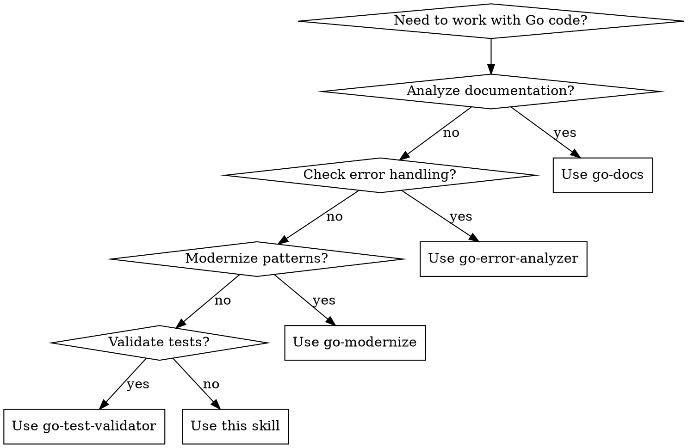

# Go Development

## Overview

Comprehensive Go development guide combining Effective Go, Google Style Guide, Uber Go Style, and modern Go 1.24+ patterns. This skill orchestrates specialized sub-skills for documentation, error handling, modernization, and testing.

## When to Use



**Always use this skill for:**
- Writing or reviewing Go code
- Refactoring existing Go code
- Adding new features to Go projects
- Code review and quality checks
- Learning Go best practices

**Then delegate to sub-skills:**
- **go-docs**: Missing/incomplete documentation
- **go-error-analyzer**: Error handling issues
- **go-modernize**: Old patterns needing updates
- **go-test-validator**: Test quality issues

## Core Principles

### Names (Effective Go + Google Style)

| Rule | Example | Avoid |
|------|---------|-------|
| Package names: short, lowercase, no underscores | `package bytes` | `package byte_utils` |
| MixedCaps for exported names | `MaxLength` | `MAX_LENGTH`, `max_length` |
| Omit Get prefix | `obj.Owner()` | `obj.GetOwner()` |
| Receivers: 1-2 letters | `(b *Buffer)` | `(buffer *Buffer)` |
| Initialisms uniform case | `URL`, `HTTP` | `Url`, `Http` |

```go
// Package bytes implements functions for the manipulation of byte slices.
package bytes

// Buffer is a variable-sized buffer of bytes with Read and Write methods.
type Buffer struct { ... }

// Reset resets the buffer to be empty.
func (b *Buffer) Reset() { ... }
```

### Error Handling (Effective Go + Google + Uber)

**Core Rules:**
1. Errors are values - check explicitly
2. Error strings: lowercase, no punctuation
3. Wrap with `%w` to allow unwrapping (place at end)
4. Use `errors.Is` and `errors.As` for inspection
5. **Handle Once** - log OR return, not both
6. Skip "failed to" prefixes in error messages

**Uber Style Additions:**
```go
// Bad: Log and return (handled twice)
if err := doSomething(); err != nil {
    log.Printf("Failed to do something: %v", err)
    return err
}

// Good: Handle once - return with context
if err := doSomething(); err != nil {
    return fmt.Errorf("do something: %w", err)
}

// Bad: "failed to" prefix
return fmt.Errorf("failed to open file: %w", err)

// Good: Clear action
return fmt.Errorf("open config: %w", err)
```

```go
// Good: wrap errors with context
if err := os.Open(file); err != nil {
    return fmt.Errorf("open config %s: %w", file, err)
}

// Good: check specific error types
if errors.Is(err, fs.ErrNotExist) {
    // handle missing file
}

// Good: extract typed errors
var pathErr *fs.PathError
if errors.As(err, &pathErr) {
    // use pathErr.Path
}
```

**Anti-patterns:**
```go
// Bad: panic for normal errors
if err != nil {
    panic(err)
}

// Bad: capitalized error strings
return errors.New("File not found")  // "file not found"

// Bad: string comparison
if err.Error() == "file not found"  // fragile
```

### Documentation (Effective Go + Google Style)

**Package Comments:**
```go
// Package bytes implements functions for the manipulation of byte slices.
// It is analogous to the facilities of the strings package.
package bytes
```

**Function Comments:**
```go
// Read reads the next len(p) bytes from the buffer or until the buffer
// is drained. The return value n is the number of bytes read. If the
// buffer has no data to return, err is io.EOF (unless len(p) is zero);
// otherwise it is nil.
func (b *Buffer) Read(p []byte) (n int, err error) { ... }
```

**Rules:**
- Complete sentence, start with name being documented
- Explain what and why, not how
- Stand on its own (no surrounding context needed)
- Use line comments (`//`), not block comments

### Interfaces (Effective Go + Google Style)

**Principles:**
1. Define where consumed, not implemented
2. Keep small (1-2 methods ideally)
3. Return concrete types, accept interfaces
4. Name with -er suffix for single method

```go
// Good: interface defined in consuming package
type Reader interface {
    Read(p []byte) (n int, err error)
}

// Good: implicit implementation
type myReader struct{}
func (r *myReader) Read(p []byte) (n int, err error) { ... }

// Good: compile-time check
var _ json.Marshaler = (*MyType)(nil)
```

### Concurrency (Effective Go)

**Core Principle:** Do not communicate by sharing memory; share memory by communicating.

```go
// Good: channels for synchronization
c := make(chan int)
go func() {
    doWork()
    c <- 1  // signal completion
}()
<-c  // wait

// Good: explicit goroutine lifecycle
go func() {
    defer wg.Done()
    // work with clear exit condition
}()
```

**Rules:**
- Make goroutine lifecycles explicit
- Prefer synchronous APIs
- Use `chan struct{}` for signals
- Close channels from sender only

## Sub-Skill Decision Matrix

| Task | Use |
|------|-----|
| "Document this code" | go-docs |
| "Add doc comments" | go-docs |
| "Check error handling" | go-error-analyzer |
| "Find unhandled errors" | go-error-analyzer |
| "Modernize code" | go-modernize |
| "Update to Go 1.22+" | go-modernize |
| "Check tests" | go-test-validator |
| "Validate test patterns" | go-test-validator |

## Quality Gates

Run before completing any Go work:

```bash
# Formatting
gofmt -l .
goimports -l .

# Static analysis
go vet ./...
staticcheck ./...

# Security
govulncheck ./...

# Testing
go test -race ./...
go test -cover ./...

# Modernization
go fix -diff .

# Documentation completeness
python3 ~/.claude/skills/go-docs/scripts/analyze_docs.py

# Error handling
python3 ~/.claude/skills/go-error-analyzer/scripts/find_unhandled_errors.py

# Pattern modernization
python3 ~/.claude/skills/go-modernize/scripts/check_modern_go.py

# Test validation
python3 ~/.claude/skills/go-test-validator/scripts/check_tests.py
```

## Quick Reference: Modern Go (1.22-1.26)

```go
// Go 1.22: range over integers
for i := range n { ... }  // not: for i := 0; i < n; i++

// Go 1.21: min/max builtins
x = max(x, minVal)  // not: if x < minVal { x = minVal }

// Go 1.18+: any alias
func f(v any) { ... }  // not: func f(v interface{})

// Go 1.24: b.Loop() for benchmarks
func BenchmarkFoo(b *testing.B) {
    for b.Loop() {  // not: for i := 0; i < b.N; i++
        doWork()
    }
}

// Go 1.25: WaitGroup.Go()
var wg sync.WaitGroup
wg.Go(processTask)  // not: wg.Add(1); go func() { ... }()
wg.Wait()
```

## Common Patterns

### Table-Driven Tests
```go
func TestAbs(t *testing.T) {
    tests := []struct {
        name     string
        input    float64
        expected float64
    }{
        {"negative", -1, 1},
        {"zero", 0, 0},
        {"positive", 1, 1},
    }
    for _, tt := range tests {
        t.Run(tt.name, func(t *testing.T) {
            if got := Abs(tt.input); got != tt.expected {
                t.Errorf("Abs(%v) = %v, want %v", tt.input, got, tt.expected)
            }
        })
    }
}
```

### Error Wrapping Chain
```go
// Each layer adds context
if err := db.Query(); err != nil {
    return fmt.Errorf("fetch user %d: %w", userID, err)
}

// Later, caller can check
if errors.Is(err, sql.ErrNoRows) {
    // user not found
}
```

### Functional Options
```go
type Server struct { ... }

type Option func(*Server)

func WithTimeout(d time.Duration) Option {
    return func(s *Server) { s.timeout = d }
}

func WithLogger(l *slog.Logger) Option {
    return func(s *Server) { s.logger = l }
}

func NewServer(options ...Option) *Server {
    s := &Server{timeout: defaultTimeout}
    for _, opt := range options {
        opt(s)
    }
    return s
}

// Usage
srv := NewServer(WithTimeout(5*time.Second), WithLogger(log))
```

## Uber Style Patterns

### Key Uber Conventions

| Pattern | Uber Style |
|---------|-----------|
| Global vars | `_defaultTimeout` (prefix with `_`) |
| Atomics | Use `go.uber.org/atomic` (type-safe) |
| Channel buffers | "One or none" - avoid arbitrary sizes |
| Enums | Start at 1 with `iota + 1` |
| Goroutines | Never fire-and-forget, no goroutines in `init()` |
| Time types | `time.Time` for instants, `time.Duration` for periods |
| Exit | Only in `main()`, delegate to `run()` |
| String conversion | Prefer `strconv` over `fmt` on hot paths |
| Line length | Soft limit of 99 characters |

### Table-Driven Tests (Uber Style)

```go
func TestParse(t *testing.T) {
    tests := []struct {
        name    string
        give    string      // input with "give" prefix
        want    *Result     // expected with "want" prefix
        wantErr error
    }{
        {name: "valid", give: "input", want: expected},
    }
    for _, tt := range tests {
        t.Run(tt.name, func(t *testing.T) {
            got, err := Parse(tt.give)
            // ... assertions
        })
    }
}
```

### Goroutine Lifecycle (Uber)

```go
// Bad: Fire and forget
go process(data)

// Good: Explicit lifecycle
type Worker struct {
    done chan struct{}
    wg   sync.WaitGroup
}

func (w *Worker) Start() {
    w.wg.Add(1)
    go func() {
        defer w.wg.Done()
        // work with exit condition
    }()
}

func (w *Worker) Stop() {
    close(w.done)
    w.wg.Wait()
}
```

## References

- [Effective Go](https://go.dev/doc/effective_go)
- [Google Go Style Guide](https://google.github.io/styleguide/go/guide)
- [Google Go Style Decisions](https://google.github.io/styleguide/go/decisions)
- [Google Go Best Practices](https://google.github.io/styleguide/go/best-practices)
- [Uber Go Style Guide](https://github.com/uber-go/guide/blob/master/style.md) (see `references/uber-style.md`)

## Related Skills

- **go-docs** - Documentation completeness analysis
- **go-error-analyzer** - Error handling validation
- **go-modernize** - Go 1.22+ pattern checking
- **go-test-validator** - Test pattern validation
